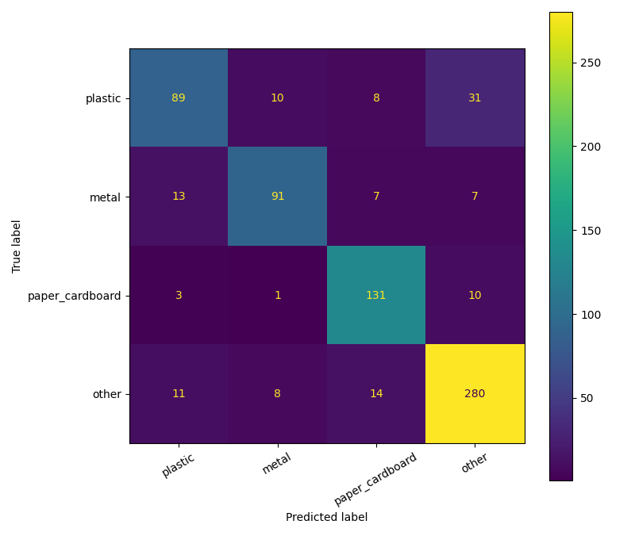

# Camera waste classifier

A TensorFlow/Keras MobileNetV2 pipeline for a camera-based waste sorter. Images are classified in this fixed order:

| Index | Class | RealWaste categories |
|---|---|---|
| 0 | `plastic` | Plastic |
| 1 | `metal` | Metal |
| 2 | `paper_cardboard` | Paper, Cardboard |
| 3 | `other` | Food Organics, Glass, Miscellaneous Trash, Textile Trash, Vegetation |

The current experiment uses **RealWaste only**. TrashNet acquisition support remains optional. This repository contains the ML pipeline; ESP32 firmware, web serving, and motor control are outside its scope.

## Status

**Trained and evaluated on RealWaste only.** Python 3.11.9, TensorFlow 2.16.1, CPU. All 9 synthetic unit tests and the pretrained smoke test passed. Both stages ran: 11 head-only epochs and 13 fine-tuning epochs, with early stopping. The final checkpoint was selected by validation accuracy, never test performance.

| Metric | Measured result |
|---|---:|
| Best validation accuracy | 85.83% |
| Held-out test macro F1 | **0.8079** |
| Held-out test accuracy | 82.77% |
| Test weighted F1 | 0.8248 |
| Coverage at fixed threshold 0.80 | 76.61% |
| Accuracy among accepted test predictions | 92.32% |

The threshold was fixed before evaluation, not tuned using test images. With RealWaste as the sole source, overall and RealWaste source metrics are identical. No TrashNet or custom-camera results are claimed. Separate-process model reload verification passed.

| Class | Train | Validation | Test | Total |
|---|---:|---:|---:|---:|
| plastic | 645 | 138 | 138 | 921 |
| metal | 554 | 118 | 118 | 790 |
| paper_cardboard | 672 | 144 | 145 | 961 |
| other | 1,454 | 313 | 313 | 2,080 |
| **Total** | **3,325** | **713** | **714** | **4,752** |

All images validated; no corrupt images or exact file duplicates were found. Plastic has the weakest test F1 (0.7008), so camera-specific validation is particularly important before operating a sorter.

[Full metrics](waste_classifier/outputs/reports/test_metrics.json) · [Model metadata](waste_classifier/models/model_metadata.json) · [Prediction examples](waste_classifier/outputs/reports/prediction_examples.json)



## Quick start

Use Python **3.10 or 3.11**. On Windows, TensorFlow runs on CPU; use a supported WSL2/Colab environment for GPU training.

```powershell
git clone --branch dev https://github.com/aimwnoaim/AI_Project.git
cd AI_Project/waste_classifier
python -m venv .venv
.\.venv\Scripts\Activate.ps1
python -m pip install -r requirements.txt
python -m src.predict --image "C:\images\bottle.jpg"
```

On Linux/macOS, activate with `source .venv/bin/activate`. Training downloads ImageNet backbone weights on first use. CPU training can take considerable time.

To reproduce training in a fresh clone (archive optional):

```powershell
python -m src.run_pipeline --realwaste-path "C:\datasets\realwaste.zip"
```

The pipeline command validates/prepares the dataset, runs synthetic unit tests, runs a small training smoke test, trains both stages with early stopping, checks export reload in another process, then evaluates the untouched test set. It stops on the first failure. It does not automatically commit or push. Archive the published `outputs/reports/test_*` files before intentionally reproducing the experiment: evaluation refuses to overwrite an existing test result. Reproduction overwrites model and training-log files, so preserve the published experiment in a separate checkout.

## Predict after training

### Laptop webcam

From `waste_classifier` in your activated Python environment:

```powershell
python -m pip install -r requirements-camera.txt
python -m src.webcam
```

Press Q or Escape to exit. Try `--camera 1` if camera 0 is not your webcam. Close Zoom/Teams or other camera apps and allow desktop camera access if the camera cannot open. Present one item at a time with good lighting. The preview shows all class scores and returns retry below the threshold; it is whole-frame classification, not object detection. Frames remain local and are not recorded or uploaded. The webcam hardware preview has not been verified on this machine.

The repository is downloadable remotely, but **no hosted inference API or web server is deployed**. Another computer can clone the repository, install dependencies, and run prediction locally. A future remote service must load the model and metadata and expose its own API.

From `waste_classifier`:

```powershell
python -m src.predict --image "C:\images\bottle.jpg"
```

The JSON response includes `label`, real maximum `confidence`, `should_sort`, and all four probabilities. At the default threshold 0.80, lower-confidence predictions return `retry`. A confident `other` prediction is accepted. Scores are uncalibrated and are not a guarantee of correctness.

For a future Python service, use `from src.predict import predict` and call `predict(image_path)`. The model is loaded once and cached. No Flask service is included.

## Project layout

```text
waste_classifier/
  src/                  acquisition, preparation, training, evaluation, inference
  tests/                synthetic-image unit tests
  data/raw/             downloaded/extracted images (ignored)
  data/processed/       reproducible manifests and dataset statistics
  data/custom/          held-out camera images (ignored)
  models/               trained Keras model and interface metadata
  outputs/plots/        learning curves and confusion matrices
  outputs/reports/      test metrics, predictions and export verification
  outputs/logs/         environment, epoch histories and acquisition records
  requirements.txt      pinned main dependencies
```

## Artifacts produced by a successful run

- `models/waste_mobilenetv2.keras`, `class_names.json`, `model_metadata.json`
- `data/processed/manifest.csv`, `statistics.json`
- `outputs/logs/history.csv`, stage logs, environment information
- `outputs/reports/test_metrics.json`, predictions CSV, classification report and confusion matrix CSV
- `outputs/plots/accuracy.png`, `loss.png`, `test_confusion_matrix.png`
- `outputs/reports/reload_verification.json`

The headline evaluation metric is **macro F1**, accompanied by accuracy and per-class precision/recall. Exact duplicate hashes and supplied item/session metadata are kept together. Physical-item independence cannot be guaranteed without reliable IDs. Results on the public dataset do not establish performance under your bin's camera and lighting.

See the [pipeline guide](waste_classifier/README.md) for individual commands, hyperparameters, metadata, camera test images, and troubleshooting.

## Data attribution

[RealWaste](https://archive.ics.uci.edu/dataset/908/realwaste): Single, S., Iranmanesh, S., & Raad, R. (2023), UCI Machine Learning Repository, [DOI 10.24432/C5SS4G](https://doi.org/10.24432/C5SS4G), CC BY 4.0. Dataset images are not redistributed here. Optional [TrashNet](https://github.com/garythung/trashnet) is by Gary Thung and Mindy Yang; consult its original repository for licensing and attribution.
